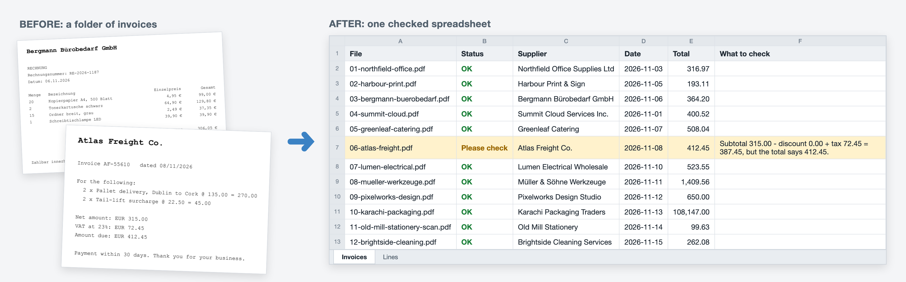

# AI invoice automation

Turn a folder of invoices into one checked spreadsheet, in seconds.



## The problem

In many offices, someone opens every invoice and types it into a spreadsheet by hand: supplier, date, each line,
tax, total.

- It is slow and boring.
- Typing mistakes are easy to make and hard to notice.
- Sometimes the invoice itself is wrong, and nobody checks the supplier's sums.

## What this tool does

You point it at a folder of invoices. It works with normal PDFs, scanned PDFs and phone photos (JPG, PNG).

1. It reads every invoice.
2. It checks the sums on every invoice.
3. It writes everything into one Excel file.
4. It marks the invoices that a person should look at, and says why.

It never changes a number to make a sum work. If something does not add up, it tells you.

## What you get

One Excel file with two sheets. You can open a real one here: [`examples/invoices.xlsx`](examples/invoices.xlsx).

**Sheet 1, "Invoices":** one row for each invoice (the picture above).

| Column | What it tells you |
|---|---|
| Status | **OK** means every sum is right. **Please check** means a person should look. These rows are yellow. |
| Supplier, Customer, Invoice no., Date, Currency | Copied from the invoice. Dates are always written the same way: year-month-day. |
| Subtotal, Discount, Tax, Total | The amounts printed on the invoice, as numbers you can sum and filter. |
| What to check | The exact problem, for example: "Subtotal 315.00 - discount 0.00 + tax 72.45 = 387.45, but the total says 412.45." |
| Notes | Extra information that is not an error, for example "Read from a picture". |

**Sheet 2, "Lines":** one row for each line of each invoice.

| File | Invoice no. | Description | Quantity | Unit price | Line total |
|---|---|---|---|---|---|
| 01-northfield-office.pdf | NF-2026-0412 | A4 copy paper, box of 5 reams | 6 | 24.50 | 147.00 |
| 01-northfield-office.pdf | NF-2026-0412 | Ballpoint pens, pack of 50 | 3 | 11.90 | 35.70 |
| 01-northfield-office.pdf | NF-2026-0412 | Desk organiser, black | 4 | 18.75 | 75.00 |

When it finishes, it also prints a short summary:

```
12 invoices read in 25 seconds.
11 passed every check.
1 need a look:
  - 06-atlas-freight.pdf: Subtotal 315.00 - discount 0.00 + tax 72.45 = 387.45, but the total says 412.45.
```

## How to use it

### Step 1: Install two things

- **uv**, which runs the tool: [install uv](https://docs.astral.sh/uv/getting-started/installation/)
- **Claude Code**, the AI that reads the invoices: [install Claude Code](https://code.claude.com/docs). Then type
  `claude` in a terminal once and sign in with your Claude account.

### Step 2: Download this project

```bash
git clone https://github.com/muhammadrao1988/ai-invoice-automation.git
cd ai-invoice-automation
```

### Step 3: Try it on the sample invoices

```bash
uv run invoices samples/invoices
```

Open `out/invoices.xlsx`. You should see 12 invoices, with one marked "Please check".

### Step 4: Use your own invoices

Put your invoices in a folder, then give the tool that folder:

```bash
uv run invoices path/to/your/folder
```

The spreadsheet is saved as `out/invoices.xlsx`.

### No Claude subscription? Use an API key

An API key is a paid key from Anthropic. You pay a small amount for each invoice. Create one in the
[Claude Console](https://platform.claude.com/), then:

```bash
export ANTHROPIC_API_KEY=sk-ant-...
uv run invoices path/to/your/folder --engine api
```

Without `--engine api`, the tool uses your Claude sign-in and ignores any API key, so you never get a bill by accident.

I built the API key option from the official documentation. I checked that it stops with a clear message when the key
is missing or wrong, but I have not yet run it with a paid key.

## How it checks its own work

An AI answer can look right and still be wrong. So the tool does not trust it:

1. The AI reads the invoice and returns the values.
2. Plain code, with no AI, does the sums: lines, discount, tax, total.
3. If a sum is wrong, the invoice is read one more time.
4. If it is still wrong, the row is marked "Please check".

## How well it works

| Test | Invoices | Time | Result |
|---|---|---|---|
| My own sample invoices | 12 | 25 seconds | Every value correct. The one wrong invoice was caught. |
| Public invoices from the internet | 20 | 33 seconds | Every value correct. |
| Public invoice pictures | 8 | 42 seconds | Every amount correct. |

One honest story: my first version got 100% on my own samples and then failed **all 20** public invoices. They did
not print a supplier name or line totals, and I had assumed every invoice does. I fixed that. The lesson: test data
you make yourself is too easy.

## What it cannot do yet

- It has been tested on 40 clean invoices. Real ones are messier, so expect more "Please check" rows.
- Blurry or tilted phone photos are not tested yet.
- A passed check means the sums are right. It does not prove that every word, like the supplier name, was read correctly.

<details>
<summary>More details: settings, tests, running on a server</summary>

**Settings**

| Setting | Default | What it does |
|---|---|---|
| `--engine cli` or `--engine api` | `cli` | Use your Claude sign-in, or an API key |
| `--out` | `out` | Folder where the spreadsheet is saved |
| `--workers` | `4` | How many invoices are read at the same time |
| `INVOICE_MODEL` | `sonnet` | AI model used with the Claude sign-in |
| `INVOICE_API_MODEL` | `claude-opus-5-5` | AI model used with an API key |

**Run the tests yourself**

```bash
uv run python eval.py                             # my 12 samples, compared with the known answers
uv run python eval_public.py fetch                # download 20 public invoices
uv run invoices samples/public --out out-public
uv run python eval_public.py                      # compare them, without AI
```

The 20 public invoices come from the Hugging Face dataset
[AyoubChLin/CompanyDocuments](https://huggingface.co/datasets/AyoubChLin/CompanyDocuments) (Apache-2.0). The 8
pictures come from the FATURA collection. I could not confirm its licence, so those pictures are not in this
project. They are computer-made with random numbers, so none of them adds up, and the tool correctly marked all 8
as "Please check".

**Running on a server, where you cannot sign in through a browser**

Run `claude setup-token` on your own computer. It creates a long-lived token for your Claude subscription and tells
you how to give it to the server (as `CLAUDE_CODE_OAUTH_TOKEN`). Treat it like a password.

**Reading pictures**

For scans and photos, the AI opens the file with one tool and nothing else. Still, treat documents from unknown
senders with normal care.

</details>

Built by [Muhammad Rao](https://github.com/muhammadrao1988) with Claude Code. MIT licence.
